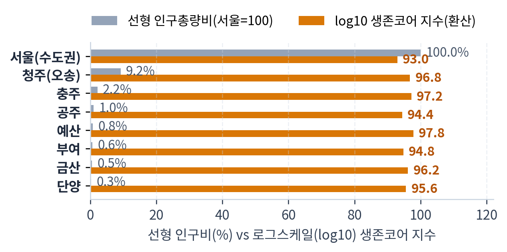

# CORE 2050 — 지능 에이전트 고속도로 & AI 햇살마을 3D HGIS·ABM 시뮬레이터

> **2026 대한민국 지방시대 엑스포(K-BALANCE 2026) 특별세션**  
> **「지방자치분권 균형발전의 회고와 2050 비전 라운드테이블」** (2026. 12. 10. 충북 청주 오송 C&V센터)  
> **라이브 워크벤치**: [https://core2050.soohwalee.com](https://core2050.soohwalee.com)



## 1. 프로젝트 개요 및 4대 핵심 아키텍처

1. **패러다임 전환 — 기성복 SW의 종언과 ‘지능 에이전트 고속도로’**: 고용 없는 콘크리트 데이터센터와 대기업 패키지형 스마트팜을 넘어, 사스포칼립스·바이브 코딩 비용 혁명(외주 600만 원 → 일회용 맞춤형 오토마타 10만 원, **98.3% 절감**)을 바탕으로 전 주민이 30~300개의 AI 에이전트(홍길동 분신)를 지휘하는 제3의 국가 균형발전 기간망 구축.
2. **실증 콘텐츠 — 로컬 ‘생존 코어(Core)’ 5대 상속 AI 스토리텔링**: 충남 예산·충북 충주·소백산권 K-애플 벨트 및 금산·부여·공주 거점의 생존 메커니즘(소르비톨 밀병·사포닌·역사 서사)을 마스터 클래스(Root Class)로 정의하여 **① 맛(스카 에디션·프로스트 바이트) · ② 체험(우드버닝 오크통 코어 에이징 1~3년 재방문 락인) · ③ 경험(딥 워크 벙커 스테이) · ④ 여행(충청 서바이버 트레일) · ⑤ 산업(K-칼바도스 증류주·애플우드 훈연칩·폴리페놀 바이오)**으로 일관 상속.
3. **시각화 물증 — 선형(Linear) 총량 지도에서 로그스케일(`log10`) 3D HGIS로의 전환**: 인구·공장 총량 비례 지도에서 바닥에 0처럼 짓눌리던 지방 읍·면 골짜기가 디지털역사학 HGIS 기반 `log10(미기후 × 30년 숙련 암묵지 × 역사·치유 서사)` 변환 즉시 황금빛 고부가가치 산업 기둥으로 융기함을 실증.
4. **2050 제도 제언 — ‘AI 햇살마을 기본사회’와 100일 실증**: 토건 신축 없는 **AI 마을방(스마트 두레)** + 수도권 은퇴 전문가 **시니어 지식 하방(下放)** + 생산력 기본권 **3단계 AI 햇살 배당(접근·참여·성과 배당)** + **3개 생활권(주민 300명·30개 프로젝트) 100일 실증**.

---

## 2. 인터랙티브 웹 시뮬레이터 3대 탭 & 단축키

| 탭 / 단축키 | 모듈명 | 핵심 인터랙션 |
| :--- | :--- | :--- |
| **`1`** (`Tab 1`) | **선형 총량 vs 로그(`log10`) 3D 코어 HGIS** | `L` 키 토글 시 3D 기둥 실시간 융기 애니메이션, 네온 KDE 히트맵, 충청 서바이버 트레일 발광 아크, 9개 거점 클릭 시 5대 상속 상세 조회 |
| **`2`** (`Tab 2`) | **2026→2050 AI 햇살마을 ABM 시뮬레이터** | 국민개발자 전환율 · 스카 에디션 전환율 · 오크통 코어에이징 락인율 3종 슬라이더 + 시니어 지식 하방 토글 기반 몬테카를로(`N=24`) 소득·생활인구·배당 궤적 비교 |
| **`3`** (`Tab 3`) | **국민개발자 일회용 오토마타 실증** | 농민 사투리·자연어 발화 한 줄 → 4개국어(KO/EN/JP/FR) 스카 에디션 직수출 스토어 & 실시간 오크통 경판 우드버닝 불도장 각인·숙성고 예약 앱 생성 |
| **`P` / `Q`** | **현장 브리핑 & QR 모달** | `P`: 4대 아키텍처 요약 모달 / `Q`: VIP 스마트폰 스캔용 `core2050.soohwalee.com` QR 모달 |

---

## 3. 디렉터리 구조

```text
core2050/
├── docker-compose.yml               # core2050_web (Nginx:80, 브리지 8092) + core2050_api (FastAPI:8000)
├── frontend/
│   ├── Dockerfile                   # nginx:alpine 정적·리버스프록시 이미지
│   ├── nginx.conf                   # gzip, SPA 라우팅, /api/ 프록시 설정
│   ├── index.html                   # 3탭 3D HGIS · ABM · 오토마타 워크벤치
│   └── assets/                      # 히어로 비주얼 및 검증 QR코드 에셋
├── backend/
│   ├── Dockerfile                   # python:3.11-slim FastAPI 헬스체크 API
│   ├── main.py                      # /api/health 엔드포인트
│   └── requirements.txt
├── tools/
│   └── deploy_oracle_core2050.py    # 오라클 도커 빌드 + Nginx Proxy Manager 네트워크 자동 연결 스크립트
├── docs/
│   ├── 2026_지방시대엑스포_특별세션_토론문_이수화.docx
│   ├── core2050_standalone_singlefile.html
│   ├── linear_vs_log10_chart.png
│   └── qr_core2050.png
└── README_DEPLOY_KR.md              # Cloudflare + Oracle Docker + NPM 상세 배포 안내서
```

---

## 4. 오라클 클라우드 Docker + Nginx Proxy Manager 원클릭 배포

```bash
git clone https://github.com/westwins/core2050.git ~/core2050
sudo python3 ~/core2050/tools/deploy_oracle_core2050.py
```

배포 스크립트가 `core2050_web` 컨테이너를 빌드·기동하고 실행 중인 **Nginx Proxy Manager** 공유 도커 네트워크에 자동 연결합니다. 이후 NPM `Add Proxy Host`에서 `core2050.soohwalee.com` → `http://core2050_web:80` + Let's Encrypt SSL만 지정하면 즉시 개통됩니다.
